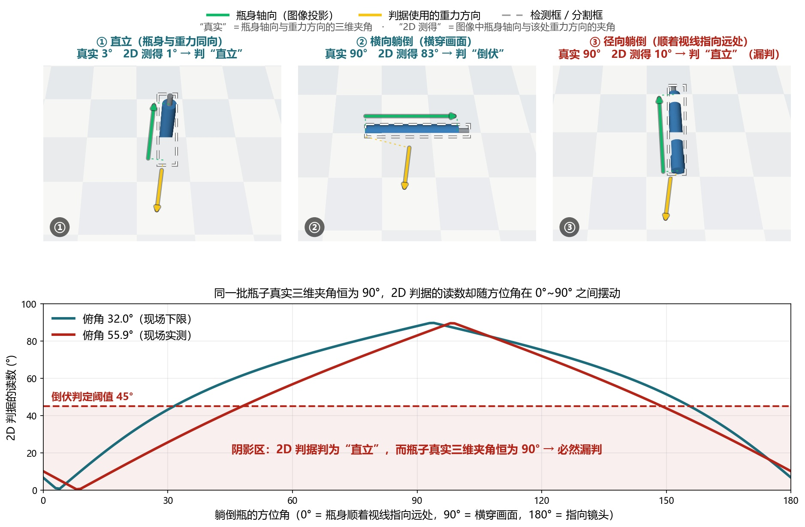
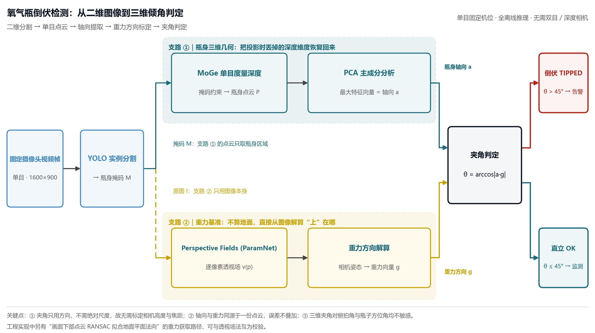
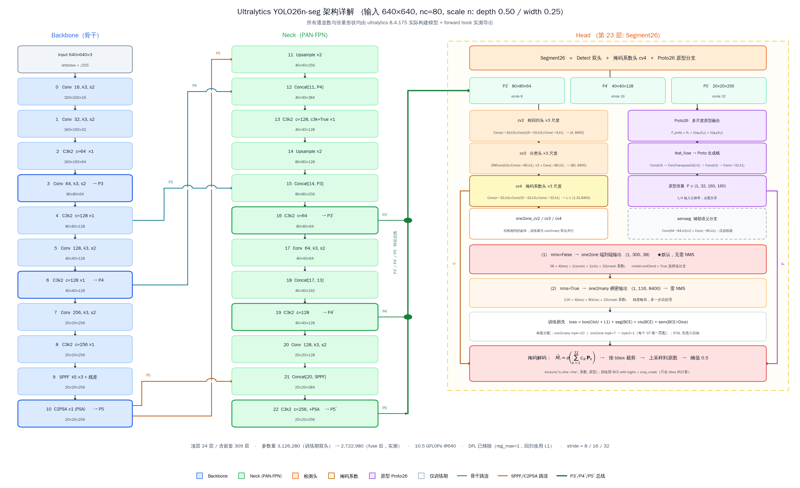
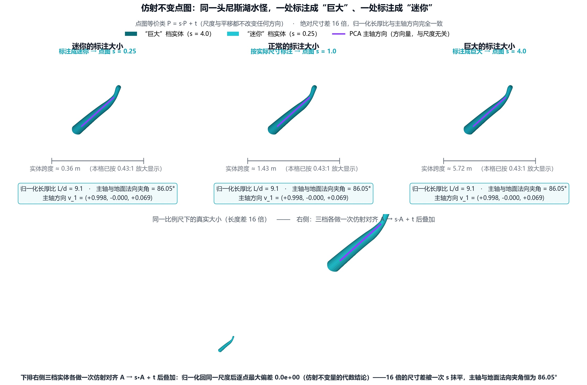
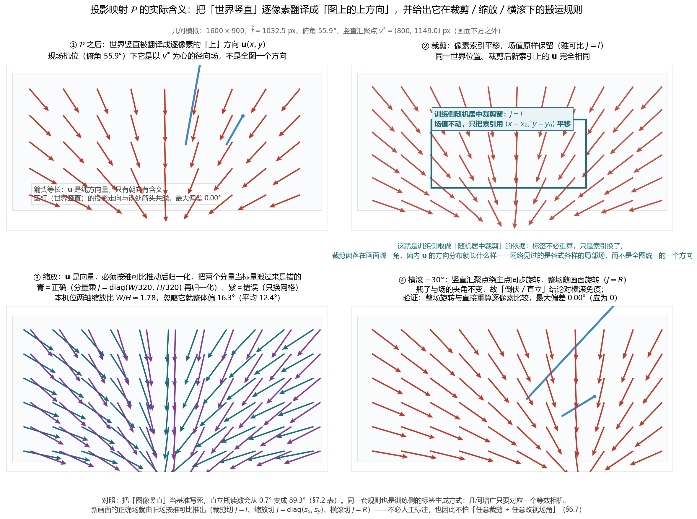
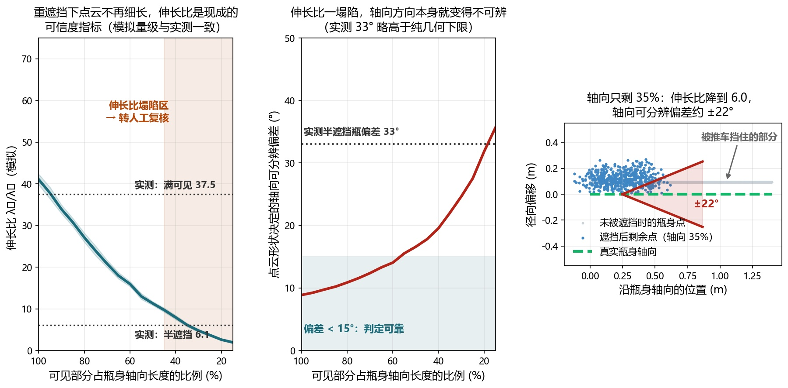
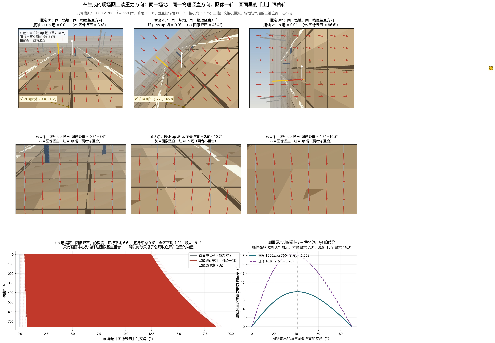
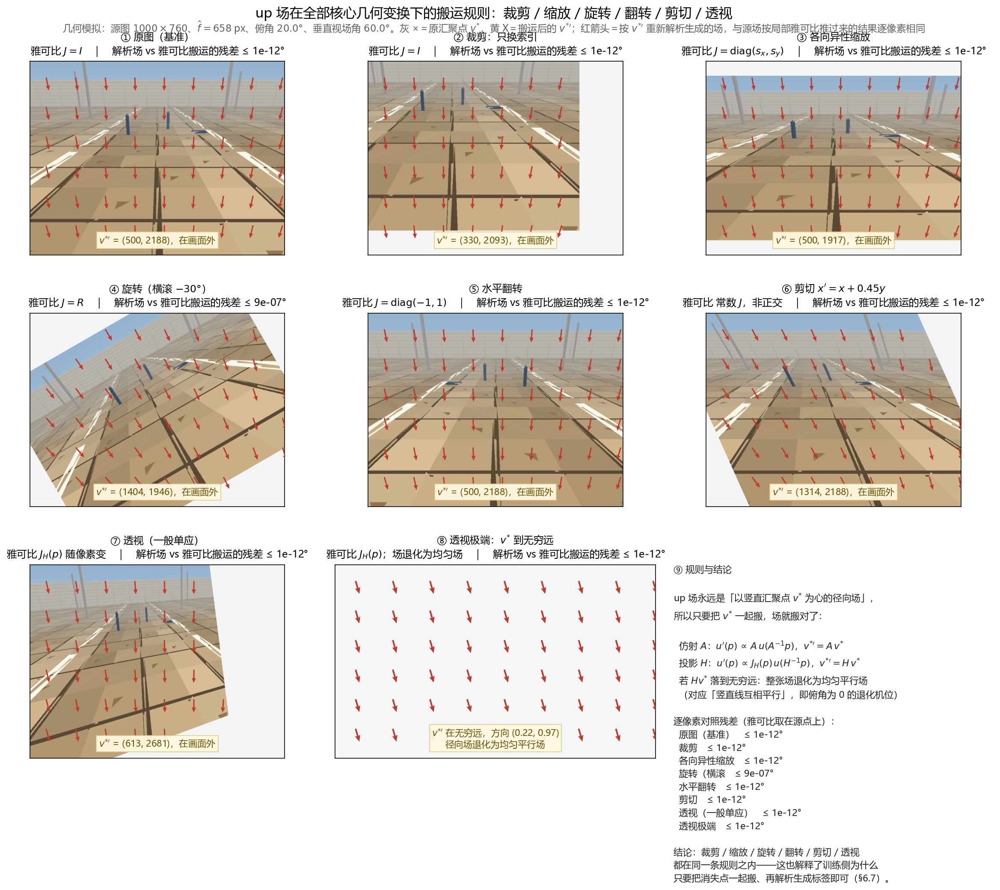
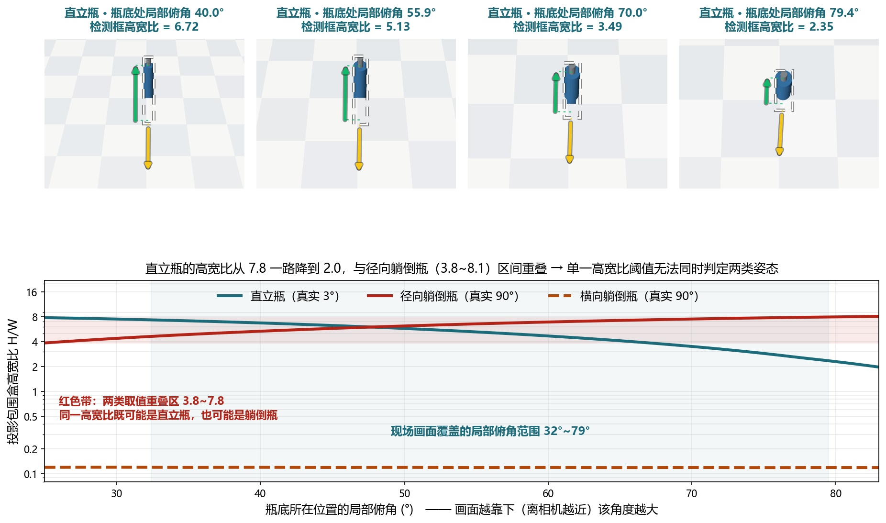

# 氧气瓶倒伏智能检测技术方案

## 一、背景：为什么"倒伏"是一个三维几何问题

氧气瓶属于承压特种设备，在车间、施工现场通常成组存放于推车或瓶架中。碰撞、支架失效、违规斜靠、地面不平或积水结冰等情况都可能使其倾倒。瓶体倒伏后不仅会磕碰损伤瓶阀与减压器，一旦瓶阀断裂，高压气体高速喷出会让瓶体失去控制甚至成为"飞弹"；而氧气本身是强助燃剂，泄漏后遇明火、油脂极易引发火灾乃至爆炸事故。因此，"瓶子是否倒伏"是现场最直接、也是最值得优先发现的安全征兆。

现场虽已部署固定摄像头用于区域监控，但目前仍依赖人工盯屏或定期巡检。氧气瓶区往往只占画面一角，倒伏通常在数秒内发生，人工很难长时间保持关注，夜间及多路视频并发时漏检风险更高，事后回溯也缺少结构化的告警记录。项目需要在此基础上增加一套自动、实时、可留存证据的倒伏检测能力。

从技术上看，"倒伏"并非简单的图像分类问题，而是瓶体轴向相对重力方向的三维姿态问题。单目图像是三维场景的透视投影，直接由二维形状判断会引入投影歧义：大俯拍角下直立瓶的投影变得"矮胖"，基于检测框高宽比的判据趋于失效；瓶子顺着视线方向躺倒（径向躺倒）时，二维投影轴向与重力的夹角很小，判据必然漏判。示例如下：

| 姿态 | 真实夹角 | 2D 测得 | 2D 结论 | 检测框高宽比 |
|---|---|---|---|---|
| ① 直立 | 3° | 1° | 直立 ✅ | 3.81 |
| ② 横向躺倒 | 90° | 83° | 倒伏 ✅ | 0.12 |
| ③ 径向躺倒 | 90° | 10° | 直立 ❌ 漏判 | 5.28 |

*图 1　三种姿态的投影对比（上）与方位角扫描（下）。*

## 二、解决方案

针对上述投影歧义，本方案不去猜测二维形状，而是把"瓶子倒没倒"还原成一个可测量的三维几何量——瓶身轴向与重力方向的真实夹角，其技术路线是"二维分割 → 单目点云 → 轴向提取 → 重力方向标定 → 夹角判定"：先用 YOLO 分割模型在画面中精确抠出瓶身掩码，把关注区域从整幅图像收缩到瓶体本身；再以该掩码为条件，用单目度量深度模型 MoGe 恢复瓶身区域的三维点云，从而把 2D 像素重新升维到具有真实尺度和朝向的三维空间；随后对瓶身点云做主成分分析（PCA），取最大特征值对应的主方向作为瓶身轴向，这一轴向由三维结构决定，天然不受方位角和俯拍角影响；与此同时，重力方向并不依赖"摄像头水平安装"这类不可靠假设，而是借助 Perspective Fields（Jin et al., CVPR 2023）从单张图像中预测逐像素的透视场，估计出相机的俯仰/横滚，进而解算出图像坐标下的重力方向；最后将瓶身轴向与重力方向统一到同一坐标系中求夹角，当夹角超过阈值时判定为倒伏。这样，径向躺倒与横向躺倒在三维空间里是同一件事，图 1 中 2D 读数 0°~90° 的摆动被彻底消解，同时该流程对机位、俯拍角度和瓶子在画面中的方位均无需额外假设，便于在既有固定摄像头上直接部署。架构图如下：

*图 2　系统架构与技术链路。*

**本文的组织方式：** 判据用到的量——像素坐标、焦距、投影关系、三维点云、瓶身轴向、重力方向——没有一个是"已知条件"，每一个都必须由前一环推出来。因此下文不按"模型介绍"的顺序，而按**推导顺序**组织：先集中登记全文符号及其来源（§3），再依次给出输入与预处理（§4）、点云与轴向（§5）、重力方向（§6），最后才是判决与阈值（§7）。

## 三、全文符号与量的来源

本文所有公式只使用下表定义的量。**每个量都注明它由哪一步产生、在哪一节推导出来**：公式里出现的符号，要么在表中，要么在引用它的那一节内当场定义，不出现"凭空出现"的中间量。表中所列"推导位置"即该量的定义处，阅读时可往返对照。

### 3.1 输入与几何量

| 符号 | 含义 | 来源 / 推导位置 | 形状与坐标约定 | 用途 |
|---|---|---|---|---|
| $I$ | 一帧输入图像 | 摄像头（BGR，`uint8`） | $H\times W\times3$ | 全流程只读不改 |
| $M$ | 瓶身二值掩码 | 检测 + 分割，§4.3 | $H\times W$，$\{0,1\}$ | 与点图、up 场同分辨率 |
| $(u,v)$ | 像素坐标（连续值） | 图像网格 | 原点在左上、$u$ 向右、$v$ 向下、单位像素 | §4.1 |
| $(x,y)$ | 像素坐标（整数索引） | 同上，遍历时用 | — | 与 $(u,v)$ 同一网格，§4.1 |
| $\mathbf{g}$ | 重力方向单位向量 | 物理事实 | 三维，模长 $1$ | "向下"为正方向 |
| $\mathbf{o}$ | "上"方向单位向量 | 定义 $\mathbf{o}=-\mathbf{g}$ | 三维，模长 $1$ | 判据中的重力参考 |
| $\mathbf{a}$ | 氧气瓶真实轴向单位向量 | 被测对象 | 三维，模长 $1$ | 待测量 |
| $\mathbf{a}_{2\text{D}}$ | 掩码的二维长轴单位向量 | 掩码 PCA，§7.2 | 二维图像坐标 | 仅 2D 降级判据使用 |
| $\mathbf{n}$ | 地面平面法向（单位） | 点云 RANSAC 拟合，§6.1 | 三维 | 需定号，见该节 |
| $\theta$ | 判定用夹角（度） | $\mathbf{a}$ 与 $\mathbf{o}$，§7.1 | $[0°,90°]$ | 系统输出的物理量 |
| $\theta_{2\text{D}}$ | 2D 降级判据的角度（度） | $\mathbf{a}_{2\text{D}}$ 与 $\mathbf{u}$，§7.2 | $[0°,90°]$ | 只用于降级路径 |
| $\Theta$ | 倒伏判定阈值 | 标定参数，§7.1 | 取 $45°$ | 全文唯一判决阈值 |

### 3.2 中间量：二维分割与单目点云

| 符号 | 含义 | 来源 / 推导位置 | 形状与坐标约定 | 用途 |
|---|---|---|---|---|
| $\mathbf{T}$ | 送入 MoGe 的输入张量 | 预处理 I，§4.1 | $3\times H\times W$，值域 $[0,1]$ | MoGe 内部再缩放 |
| $\mathbf{T}'$ | 送入 ParamNet 的输入张量 | 预处理 II，§6.5 | $3\times320\times320$，值域 $[0,255]$ | 输入是**图像**，非场 |
| $\mathbf{P}$ | MoGe 输出的**点图** | 模型输出，§5.1 | $H\times W\times3$，逐像素三维坐标 | 后续一切几何量的唯一来源 |
| $\mathbf{p}_i$ | 点图中的一个三维点 | $\mathbf{P}$ 的取值，§5.1 | 三维，相机坐标 | 与像素 $(u_i,v_i)$ 一一对应 |
| $\mathbf{M}$ | 有效性掩码 | MoGe 输出，§5.1 | $H\times W$，$\{0,1\}$ | 天空、无定义区域为 $0$ |
| $\bar{\mathbf{p}}$ | 瓶身点云质心 | 由 $\mathbf{p}_i$ 求均值，§5.3 | 三维 | — |
| $\mathbf{C}$ | 瓶身点云协方差矩阵 | 由 $\mathbf{p}_i$、$\bar{\mathbf{p}}$ 构造，§5.3 | $3\times3$，实对称半正定 | — |
| $(\lambda_k,\mathbf{v}_k)$ | $\mathbf{C}$ 的特征值与特征向量 | 特征分解，§5.3 | $\lambda_1\ge\lambda_2\ge\lambda_3\ge0$ | $\mathbf{a}=\mathbf{v}_1$ |
| $\kappa$ | 伸长比 | $\lambda_1/\lambda_3$，§5.4 | 标量，$\ge1$ | 结果可信度指标 |
| $f$ | 相机焦距（像素） | 由点图反解，§5.2 | 标量 | 全流程只需 $f$，不需内参矩阵 |
| $c_x,c_y$ | 主点坐标 | 代码取图像中心，§5.1 | 像素 | $c_x=W/2$、$c_y=H/2$ |
| $\hat{f}$ | $f$ 的稳健估计（中位数） | §5.2 | 标量 | 用于一切三维↔二维投影 |
| $\mathcal{P}$ | 正投影映射（三维点 → 像素） | 针孔模型，§5.2 式 (5.3) | $\mathbb{R}^3\to\mathbb{R}^2$ | 反投影由 $\mathbf{P}$ 直接给出；**方向量的唯一来源**见 $\mathcal{J}$ |
| $J_{\mathcal{P}}$ | $\mathcal{P}$ 对三维位置求导的雅可比 | 对式 (5.3) 求导，§5.2 | $2\times3$ | 把三维方向推成图上方向 |
| $\mathcal{J}$ | 由 $\mathcal{P}$ 得到的**逐像素方向场算子** | §5.2 式 (5.8) | 三维方向 → 二维单位向量场 | up 场 $\mathbf{u}$ 与轴向投影都由它给出 |
| $T$ | 图像域的几何变换 | 裁剪 / 缩放 / 旋转 / 翻转 / 剪切 / 透视，§5.2 式 (5.9) | $2\times2$ 仿射，或 $3\times3$ 齐次单应 | 训练增广与分辨率还原都属于此类 |
| $J_T$ | $T$ 在**源点**处的雅可比 | 对 $T$ 求导，§5.2 式 (5.9) | $2\times2$ | 把源场推到新画面；仿射时为常数，单应时随像素变 |
| $J$ | 分辨率还原用的缩放雅可比 | §6.6 | $2\times2$ | $J=\operatorname{diag}(W/320,\,H/320)$ |
| $\sigma_k$ | 第 $k$ 个方向的均方伸展 | $\sqrt{\lambda_k}$，§5.3 | 长度量纲 | 用于解释"细长" |

### 3.3 中间量：重力场的表示

| 符号 | 含义 | 来源 / 推导位置 | 形状与坐标约定 | 用途 |
|---|---|---|---|---|
| $\mathbf{u}(x,y)$ | 像素 $(x,y)$ 处的 up 向量 | 定义见 §6.3，也可写作 $\mathcal{J}(\mathbf{X}(x,y);\mathbf{n})$ | 二维单位向量，图像坐标 | **是像素坐标的函数**；本文不用 $u_x$ 这类下标写法，以免与分量指数混淆 |
| $\boldsymbol{\mu}$ | 任取的三维单位方向（"要投影的是什么方向"） | §5.2 式 (5.8) | 三维 | 取 $\mathbf{n}$ 得 up 场，取 $\mathbf{a}$ 得轴向投影 |
| $\varphi(x,y)$ | 像素 $(x,y)$ 处的纬度角 | 定义见 §6.3 | 标量，度 | 本方案未使用 |
| $\mathbf{R}(x,y)$ | 像素 $(x,y)$ 对应的入射光线方向 | 针孔模型，§6.3 | 三维 | 仅用于定义 $\varphi$ |
| $v^{*}$ | 竖直方向的汇聚点纵坐标 | 解析式，§6.3 | 像素 | 现场机位下 $v^{*}\approx1149$，在画面外 |
| $\bar{\mathbf{u}}(x,y)$ | 标定后的平均 up 场 | 多帧平均，§7.4 | $H\times W\times2$ | 运行时查表 |
| $\hat{f}_{\text{model}}$ | 现场等效焦距 | 由垂直视场角与画面高算出，§3.4 | 标量 | 与 $\hat{f}$ 互校 |

### 3.4 现场标定与实测常数（全文复算共用）

| 量 | 取值 | 来源 |
|---|---|---|
| 画面尺寸 $W\times H$ | $1600\times900$ | 现场机位 |
| 相机俯角 $\theta_{\text{dep}}$ | $55.9°$ | 现场实测（设计区间 $32°\sim56°$） |
| 垂直视场角 $\theta_{\text{vfov}}$ | $47.1°$ | 现场实测 |
| 相机离地高度 | $4.5$ m | 现场实测 |
| 等效焦距 $\hat{f}_{\text{model}}$ | $(H/2)/\tan(\theta_{\text{vfov}}/2)=1032.5$ px | 由上行两式算出 |
| 竖直汇聚点 $v^{*}$ | $c_y+\hat{f}_{\text{model}}\cot\theta_{\text{dep}}=1149.0$ px | §6.3 解析式 |
| 瓶体几何 | 高 $L=1.40$ m、半径 $R=0.095$ m | 实物尺寸 |
| 倒伏阈值 $\Theta$ | $45°$ | §7.1 |
| 伸长比门限 | $2.0$ | §5.4 |

**坐标约定（全文唯一一套，不允许中途更换）：**

1. **相机坐标系**：原点在光心，$x$ 轴向右、$y$ 轴向下（与图像 $v$ 轴同向）、$z$ 轴沿光轴向前。MoGe 点图的所有三维点都在这个系里；§5.2 由点图反解焦距、§6.1 给地面法向定号，用的都是这套约定。
2. **图像坐标系**：$(u,v)$ 连续像素坐标，原点在左上角，与相机坐标系通过 §5.2 的针孔模型关联；离散取整后记为 $(x,y)$。
3. **二维场坐标系**：up 场逐像素存储为两个通道（通道 0 为 $x$ 分量、通道 1 为 $y$ 分量），与图像坐标系逐像素对齐。
4. 四个模型（YOLO、SAM3、MoGe、ParamNet）**共用同一张原图与同一份分辨率**，因而掩码、点图、场三者的像素索引严格一一对应。这一条是"把掩码直接当作点图的索引"的前提，也是全文所有"逐像素"操作的合法性依据。

> 说明：点图的坐标轴符号（$y$ 向上还是向下）属于模型实现的全局取向约定；由于后续只用**主方向**与**夹角**（§5.3、§7.1），任何坐标轴的统一反向都不改变结论，因此本方案不依赖该取向的确切取值，但要求全流程保持一致——这也是本节把坐标约定单列的原因。

### 3.5 量的来源索引

每个判定量从输入到结论只经过下面五步，每步的输入输出都已在表中登记：

| 步 | 输入 | 操作 | 输出 | 参见 |
|---|---|---|---|---|
| 1 | $I$ | 检测 + 分割 | 掩码 $M$ | §4.3 |
| 2 | $I$、$M$ | 预处理 I → MoGe → 后处理 | 点图 $\mathbf{P}$、有效性 $\mathbf{M}$ | §4.1、§5.1 |
| 3a | $\mathbf{P}$、$M$ | 取值 + PCA | 轴向 $\mathbf{a}$、伸长比 $\kappa$ | §5.3 |
| 3b | $\mathbf{P}$ | 地面拟合 + 定号 | 重力 $\mathbf{o}=\mathbf{n}$ | §6.1 |
| 4 | $I$ | 预处理 II → ParamNet → 后处理 | up 场 $\mathbf{u}(x,y)$ | §6.5、§6.6 |
| 5 | $\mathbf{a}$（或 $\mathbf{a}_{2\text{D}}$）、$\mathbf{o}$（或 $\mathbf{u}$） | 夹角判据 | $\theta$、倒伏与否 | §7 |

**易混淆点澄清：** 点图 $\mathbf{P}$ 与重力 $\mathbf{o}$ 来自同一次 MoGe 前向（同一份点云），所以 §7.1 的三维判据不需要任何坐标系变换或外参标定；而 $\mathbf{u}(x,y)$ 来自另一个模型，属于另一条独立路径，只在降级与互校时使用（§7.3）。

## 四、输入、预处理与坐标约定

### 4.1 预处理 I：MoGe 侧

预处理只服务于网络输入，几何计算全部回到原图分辨率进行：

1. 读入 BGR 图像 $I$，转 RGB；
2. 转为 `float32` 并归一化到 $[0,1]$，再转成 $3\times H\times W$ 张量 $\mathbf{T}$；
3. 送入网络前由模型内部把图像缩放到预设输入尺寸，并补齐到 patch 尺寸的整数倍，同时记录缩放与补齐参数，用于把输出精确还原到原图分辨率；
4. 网络内部对输入做通常的像素均值/方差归一化与分块（patch）嵌入。

需要明确的是：**本方案不引入任何额外的图像预处理**——不做直方图均衡、不做锐化、不做事先裁剪。分割掩码（YOLO/SAM3）与点云估计在同一张原图上独立完成，因此掩码与点云逐像素一一对应；相机移动、变焦或分辨率变化后，点云必须重新推理（工程上由 `refresh()` 保证）。

第 3 步的"记录缩放与补齐参数、把输出还原到原图分辨率"是后面 $\mathbf{P}$ 能与掩码同索引的原因；本节只用文字交代，具体到 §5.1 会给出输出的确切形状与含义。

### 4.2 预处理 II：ParamNet 侧（先给结论，细节见 §6）

ParamNet 的预处理与 MoGe 不同：图像被**不保持宽高比**地压到 $320\times320$，像素值保持 $0\sim255$，逐通道减均值后送入网络；输出场再按 §6.6 的规则还原到原图分辨率。之所以提前说明，是因为 §6.4、§6.6 共用一套"几何变换如何推动方向量"的规则，先知道"两侧分辨率不同、必须还原"才能理解那两节在解决什么问题。

### 4.3 二维分割：掩码 $M$ 与它的用途

YOLO 负责定位与分类，SAM3 以检测框为提示给出贴身掩码；二者产出的是与原图同分辨率的二值掩码 $M\in\{0,1\}^{H\times W}$（此处不展开通用技术原理）。掩码在本方案中有**三个**用途，都依赖 §3.4 约定的"像素索引一一对应"：

1. **选点**：把点图 $\mathbf{P}$ 在 $M=1$ 且有效性 $\mathbf{M}=1$ 处的取值取出来，得到瓶身点云 $\{\mathbf{p}_i\}$（§5.3）；
2. **定位取值**：取掩码质心作为该瓶在画面中的位置，用于查该处的 up 向量（§7.2）；
3. **二维降级**：直接对掩码像素做二维 PCA 得到长轴 $\mathbf{a}_{2\text{D}}$（§7.2）。

## 五、三维主管线：点云、轴向与重力

### 5.1 第一步输出：MoGe 点图 $\mathbf{P}$

MoGe（Wang et al., CVPR 2025）是一个单目几何估计模型，给定一张图像直接回归每个像素的三维坐标，即一张与图像同分辨率的**点图** $\mathbf{P}\in\mathbb{R}^{H\times W\times3}$。这就是 §3.2 表中 $\mathbf{P}$ 的定义处：**后文出现的任何三维点 $\mathbf{p}_i$，都是这张点图在像素 $(u_i,v_i)$ 处的取值** $\mathbf{p}_i=\mathbf{P}(u_i,v_i)$，不存在第二个来源。

与"先估深度、再用相机内参反投影"的两段式做法不同，它跳过了相机内参标定这一环；与同样输出点图的 DUSt3R 相比，它采用**仿射不变**（affine-invariant）表示，这一差别正是本方案能直接复用其输出的原因之一。本方案使用 MoGe-2 ViT-L 权重（Wang et al., 2025），其主干与监督方式沿用 MoGe，另增加了度量尺度与细节锐化能力，本方案只用其几何部分，度量尺度不参与判据。

**（1）仿射不变点图表示**

三维点云在**全局尺度** $s\in\mathbb{R}$ 与**三维平移** $\mathbf{t}\in\mathbb{R}^3$ 下不可区分，网络预测的只是等价类：

$$\mathbf{P}\;\cong\;s\,\mathbf{P}+\mathbf{t},\qquad \forall s,\ \forall \mathbf{t}$$

训练时可以任取一组对齐参数把预测搬到真值坐标系里算损失，因此不存在"该学哪个绝对尺度"的歧义。这一设定的好处是消解了单目几何里著名的**焦距–距离歧义**：焦距变长、相机退远的画面在图像上几乎一致，若强行约束尺度不变（只允许缩放），这两类情况会给出相互矛盾的监督信号；允许一次平移之后二者可以用平移补偿，监督信号重新自洽，网络学到的是稳定的相对几何，示例如下：

*图 4　仿射不变点图表示示意。*

对本任务而言这一点至关重要：我们既不需要瓶子的绝对尺寸，也不需要相机到瓶子的真实距离，只用到两样东西——瓶身点云的主方向（§5.3）、地面点云的法向（§6.1）——**两者都是方向量，而尺度与平移不改变任何方向**。所以点云能否"对齐到米"完全不影响判据，这也是 MoGe 可以免标定直接上现场机位的原因。

**（2）模型架构与三个输出头**

MoGe 的结构刻意保持简单：**ViT 编码器 + 卷积解码器**，编码器给出多尺度特征，解码器逐级上采样，最后由若干解码头并行输出：

| 输出头 | 符号 | 形状与含义 | 本方案用途 |
|---|---|---|---|
| 点图 | $\mathbf{P}$ | $H\times W\times3$，每像素三维坐标（仿射不变，相机在原点、$x$ 右 $y$ 下 $z$ 前） | 全部几何计算的输入（§5.2、§5.3） |
| 法向 | — | $H\times W\times3$，每像素表面法向 | 未使用（可用于后续地面/瓶面约束） |
| 有效性 | $\mathbf{M}$ | $H\times W$，该像素几何是否定义（天空、纯背景等为无定义） | 二值化后作为点云有效性掩码 |

本方案只取 $\mathbf{P}$ 与 $\mathbf{M}$ 两项，且**它们已经是原图分辨率**，不需要再做插值恢复。其中点图的 $x$、$y$ 轴分别与图像 $u$、$v$ 轴对齐（而非与相机光轴绑定），主点按惯例取图像中心、像素为正方形，因此 §5.1（1）中的平移只剩 $z$ 方向一个自由度 $t_z$——这是 §5.2 能把"焦距"从点图里解出来的前提。

**（3）训练监督**

MoGe 的精度主要来自监督信号的设计，训练损失由四部分组成：

- **全局点图损失**：先把预测与真值做一次最优仿射对齐，再算逐点误差，并按深度的倒数 $1/z_i$ 加权以平衡远近景的梯度量级：

$$\mathcal{L}_{G}=\sum_{i\in\mathcal{M}}\frac{1}{z_i}\bigl\|s\,\hat{\mathbf{p}}_i+\mathbf{t}-\mathbf{p}_i\bigr\|_1$$

  对齐参数 $(s^*,\mathbf{t}^*)$ 由 L1（绝对值）残差最小化求出，截断后对离群点稳健；论文给出一个可并行的求解器（ROE，Robust-Optimal-Efficient），把朴素线性规划的 $O(N^3)$ 复杂度降到 $O(N^2\log N)$，使其能在训练中按 batch 调用。
- **多尺度局部几何损失**：只用全局对齐无法约束"物体之间的相对远近"，论文以真值点为中心、按图像对角线的固定比例取球邻域，对每个邻域**独立**求一次仿射对齐后计算误差，尺度参数 $\alpha$ 取 $1/4$、$1/16$、$1/64$ 三级。这一项直接提升的是局部形状精度——恰好是我们拟合地面平面（§6.1）、提取瓶身主轴（§5.3）时所依赖的。
- **法向损失**：由点图相邻像素叉积得到法向，与真值求夹角误差。
- **掩码损失**：监督有效性掩码，真值中天空用 SegFormer 分割得到。

训练数据由约 21 个公开数据集混合而成、合计约 900 万帧，并对不同来源的数据配用不同层级的损失组合；真实标注的噪声较大，按逐像素损失剔除最高的 5%。

### 5.2 从点图到投影：焦距的标定与 $\mathbf{P}$ 的可测量性

点图给出三维点，但要把它画回图像、要与掩码逐像素对照，还需要一个投影关系。这一节把投影参数**从点图本身解出来**，从而避免引入任何外部标定。

**（1）为什么点图里还缺一个焦距**

按 §3.4 的相机坐标系与针孔模型，像素 $(u_i,v_i)$ 与它的三维点 $\mathbf{p}_i=(X_i,Y_i,Z_i)^{\mathsf T}$ 满足

$$u_i=\hat{f}\frac{X_i}{Z_i}+c_x,\qquad v_i=\hat{f}\frac{Y_i}{Z_i}+c_y \tag{5.1}$$

其中 $c_x=W/2$、$c_y=H/2$ 由 §3.4 的约定直接给定，剩下的唯一未知量是像素焦距 $f$。注意 $\mathbf{P}$ 只给出 $(X_i,Y_i,Z_i)$，**它并不直接给出 $f$**：仿射不变表示允许 $s$ 与 $t_z$ 任意取值，而 $(s,t_z)$ 与 $f$ 在式 (5.1) 里是耦合的（缩放点云等价于改变焦距）。因此 $f$ 必须与点图一起被"解"出来，而不能查手册得到。

**（2）解出焦距**

把式 (5.1) 反解，每个有效像素都给出一个 $f$ 的候选值：

$$f_i^{(x)}=\frac{(u_i-c_x)Z_i}{X_i},\qquad f_i^{(y)}=\frac{(v_i-c_y)Z_i}{Y_i} \tag{5.2}$$

代码对两个方向分别统计后取中位数得 $\hat{f}$，并排除 $|X_i|<0.05|Z_i|$（该条件下式 (5.2) 的病态程度高）与 $|Z_i|\le10^{-6}$ 的点。这与 MoGe 原文"最小化重投影误差求解 $f$ 与 $t_z$"是同一件事的稳健化实现——原文的迭代解法约 10 次迭代、约 33 ms 收敛，我们改用中位数是为了避免个别错误点带动焦距估计。

**（3）投影与反投影，以及它们的自洽性**

得到 $\hat{f}$ 后即可正反投影：

$$\mathcal{P}:\ (X,Y,Z)\mapsto\Bigl(\hat{f}\frac{X}{Z}+c_x,\ \hat{f}\frac{Y}{Z}+c_y\Bigr);\qquad \text{反投影由点图直接给出} \tag{5.3}$$

正反投影在同一个 $(\hat{f},c_x,c_y)$ 下自洽：把三维轴向、重力箭头画回原图（§7.5）时不会出现错位。**这一步之后，$\mathbf{P}$ 与图像像素之间就有了双向可查的对应关系**，§5.3 的取值、§6.3 的解析复算、§7.5 的可视化全部建立在这个对应关系上。

**（4）一致性校验**

$\hat{f}$ 由式 (5.2) 从点图解出，而由现场视场角可独立算出 $\hat{f}_{\text{model}}=(H/2)/\tan(\theta_{\text{vfov}}/2)=1032.5$ px（§3.4）。两者互校：实拍导出点云的反解值与该式相差在百分之几以内，说明点图的主点居中、像素为正方形这两条假设在本机位上成立。若二者出现数量级差异，应首先怀疑网络输出未还原到原图分辨率。

**（5）$\mathcal{P}$ 到底带来了什么：三维方向 → 逐像素方向场**

式 (5.3) 是一行不起眼的公式，但它是后面一切"方向量"的来源，值得在这里把它讲透——**$\mathcal{P}$ 把"三维的一个方向"变成"图像上的一整张逐像素方向场"**。做法是：在某个像素对应的世界点 $\mathbf{X}$ 处，沿三维单位方向 $\boldsymbol{\mu}$ 挪动无穷小一步，问这一步在图像上把该像素往哪个方向推，把结果归一化后逐像素存下来：

$$\mathcal{J}\bigl(\mathbf{X};\boldsymbol{\mu}\bigr)=\frac{J_{\mathcal{P}}(\mathbf{X})\,\boldsymbol{\mu}}{\lVert J_{\mathcal{P}}(\mathbf{X})\,\boldsymbol{\mu}\rVert_2}\in\mathbb{R}^2 \tag{5.8}$$

其中 $J_{\mathcal{P}}(\mathbf{X})$ 是式 (5.3) 对三维位置求导得到的 $2\times3$ 雅可比矩阵，$\mathbf{X}$ 遍历各像素对应的三维点，于是 (5.8) 逐像素给出一张二维单位向量场。取 $\boldsymbol{\mu}=\mathbf{n}$（地面法向，即重力反方向）就得到"该像素处向上的方向"，也就是 §6.3 的 up 场 $\mathbf{u}(x,y)$；取 $\boldsymbol{\mu}=\mathbf{a}$（瓶身轴向）就得到"瓶身轴向在该像素处的投影方向"——§7.6 把三维轴线画回原图用的就是它。

**（5.8）式是全文"方向量"的统一来源**，也是理解后面三件事的钥匙：

1. **为什么模型不需要人工标注重力方向**：$\boldsymbol{\mu}$ 是已知的（训练时由全景相机的相机参数解析给出），$\mathcal{P}$ 也是已知的（针孔投影），于是整张场可以**逐像素算出来**，不必请人标（§6.7）；
2. **为什么场能精确跟着几何增广走**：图像做几何变换 $T$（$p'=T(p)$）时，$\mathcal{P}$ 变成 $\mathcal{P}\circ T^{-1}$，雅可比按链式法则变成 $J_{\mathcal{P}}(T^{-1}p')\,J_{T^{-1}}(p')$，于是旧场到新场是一次**精确搬运**（式 (5.9)）——裁剪、缩放、旋转/翻转、剪切、透视都只是不同形式的 $T$；
3. **为什么"逐像素"不可省**：$\mathcal{J}$ 依赖 $\mathbf{X}$，同一个世界方向在不同像素上给出不同的图上方向（§6.3、§6.4 的定量结果）。

$$p'=T(p)\ \Rightarrow\ \mathbf{u}'(p')=\frac{J_T\bigl(T^{-1}p'\bigr)\,\mathbf{u}\bigl(T^{-1}p'\bigr)}{\bigl\lVert J_T(T^{-1}p')\,\mathbf{u}(T^{-1}p')\bigr\rVert_2}
\tag{5.9}$$

其中 $J_T(p)$ 是 $T$ 在 $p$ 处的 $2\times2$ 雅可比，**必须取在源点 $p=T^{-1}p'$ 上**（仿射时它是常数，投影时随像素变化——这一点容易写错，写错的后果见图 8 的注记）。取不同的 $T$ 就得到全部核心变换：

| $T$ | $J_T$ | 说明 |
|---|---|---|
| 平移（裁剪） | $I$ | 场值一个像素都不用重算，只换索引 |
| 各向异性缩放 | $\operatorname{diag}(s_x,s_y)$ | 必须**逐分量**作用后再归一化 |
| 旋转 / 横滚、翻转 | $R$ / $\operatorname{diag}(\pm1,\pm1)$ | 整场同步旋转；$\det<0$ 时取向翻转，判据取 $\lvert\cdot\rvert$ 后不变 |
| 剪切 | 常数、非正交矩阵 | 不是旋转：它会把竖直汇聚点**搬家**（图 8 面板 ⑥） |
| 一般单应（透视） | $J_H(p)$，随像素变 | 场仍是径向场，只是心搬到了 $H v^{*}$（图 8 面板 ⑦） |
| 单应且 $H v^{*}\to\infty$ | $J_H(p)$ | 整张场**退化为均匀平行场**（竖直结构互相平行，对应俯角为 0，图 8 面板 ⑧） |

**换一个更省事的等价说法**：up 场永远是以竖直汇聚点为心的径向场，所以搬运场 = **搬运那个心**——仿射取 $v^{*\prime}=A v^{*}$，投影取 $v^{*\prime}=H v^{*}$（齐次坐标下直接乘矩阵即可；若 $w=0$ 即落到无穷远）。训练侧的标签生成用的正是这个版本：把消失点先搬运、再在新网格上重新解析生成场（§6.7）。

图 5 把这三点画成了四张对照图（几何模拟，现场机位参数），每一张都附了逐像素检验的数字；其中"场随画面一起转"这一条，在图 7 的**生成现场图**上更直观（同一场地、同一物理竖直方向，只改相机横滚）：

*图 5　$\mathcal{P}$ 之后得到的逐像素方向场，以及 $T=I$（裁剪）、$T=\operatorname{diag}(s_x,s_y)$（缩放）、$T=R$（横滚）三种搬运规则。*

| 面板 | 做了什么 | 结论（逐像素检验） |
|---|---|---|
| ① | 现场机位下的 up 场 | 是以竖直汇聚点 $v^{*}$ 为心的径向场；每根世界竖直杆的投影走向与该处箭头共线，最大偏差 $<10^{-6}$° |
| ② | 只换索引（裁剪切 $T=I$） | 同一世界位置在新索引上的 $\mathbf{u}$ 完全相同，偏差 $0.00$°——所以裁剪不必重算标签 |
| ③ | 把场搬到 $320\times320$ 再搬回来 | 必须按 $J=\operatorname{diag}(W/320,H/320)$ 逐分量缩放；把两个分量当标量直接搬，$W/H\approx1.78$ 就足以让方向整体偏 $16.3$°（平均 $12.4$°） |
| ④ | 相机横滚 $-30°$ | $v^{*}$ 绕主点同步旋转，整场随画面旋转（$T=R$）：与"把无横滚的场做同一旋转"逐像素比较偏差 $0.00$° |

这四张图合起来说明一件事：**在这个表示里，"重力方向场"并不是一个可以随便拟合的 $2\times H\times W$ 张量，它被式 (6.4) 约束成"以某个点 $v^{*}$ 为心的径向场"**——整张场只由 $v^{*}$ 这一个二维参数决定。网络要学的因此只是"从画面内容读出 $v^{*}$ 在哪"（竖直结构的汇聚点），而不是逐像素硬记方向；判据使用的那一列向量也就自动落在物理允许的方向上。这也解释了为什么上表②③④三种搬运规则可以精确成立：它们其实是同一个几何事实（$v^{*}$ 的平移 / 轴向缩放 / 旋转）在逐像素层面的表现。

图 5 的面板 ①、④ 同时回答了一个容易误解的问题：**"重力方向"在单目图像里并不是一个常数向量**。它是一张随像素位置变化的场（面板 ①），并且只随相机的横滚旋转而整体旋转（面板 ④）——这就是 §6.4 与 §7.2 中"必须逐像素取值"以及"判据对横滚免疫"的几何根据。

### 5.3 瓶身轴向：掩码约束下的 PCA

瓶身是一条**细长的旋转体**：沿轴线方向的点跨度约 $1.4$ m，而径向上只有约 $0.095$ m 半径。对这样一个点云，可以用主成分分析（PCA）把它的走向直接算出来，不需要拟合圆柱、不需要知道瓶子在画面中的方位，也不需要任何姿态模板。

**（1）出发点：为什么 PCA 适合这件事**

一瓶氧气的点云可以看作"沿轴向的均匀分布 + 沿径向的圆盘分布"两部分叠加，两个方向的尺度相差一个数量级。PCA 要找的就是点云方差最大的那个方向——对细长体而言，这个方向必然沿轴。因此它是**由三维结构本身决定的**，而不是由二维投影形状决定的：瓶子转到画面哪个方位角、相机俯拍到什么角度，都不改变这个事实。这也正是它能消解图 1 那条 2D 盲区的根本原因。

**（2）数学表述**

从 §3.2 的约定出发，记瓶身点云为 $\{\mathbf{p}_i\}_{i=1}^{N}\subset\mathbb{R}^3$（即 $\mathbf{P}$ 在 $M=1$ 且 $\mathbf{M}=1$ 处的取值），质心 $\bar{\mathbf{p}}=\frac{1}{N}\sum_i\mathbf{p}_i$，中心化后构造协方差矩阵：

$$\mathbf{C}=\frac{1}{N-1}\sum_{i=1}^{N}(\mathbf{p}_i-\bar{\mathbf{p}})(\mathbf{p}_i-\bar{\mathbf{p}})^{\mathsf T}\in\mathbb{R}^{3\times3} \tag{5.4}$$

对 $\mathbf{C}$ 做特征分解 $\mathbf{C}=\mathbf{V}\boldsymbol{\Lambda}\mathbf{V}^{\mathsf T}$，特征值降序 $\lambda_1\ge\lambda_2\ge\lambda_3\ge0$，对应特征向量 $\mathbf{v}_1,\mathbf{v}_2,\mathbf{v}_3$（代码用 `np.linalg.eigh`，协方差矩阵实对称半正定，数值上稳定；该函数返回升序特征值，代码取末位，等价于本文的 $\lambda_1$）。由于 $\mathbf{C}$ 是二次型矩阵，$\lambda_k$ 恰好是点云在第 $k$ 个主方向上的方差，$\sigma_k=\sqrt{\lambda_k}$ 是该方向的均方伸展。取

$$\boxed{\;\mathbf{a}=\mathbf{v}_1\;}\qquad\text{（瓶身轴向单位向量）} \tag{5.5}$$

特征值的大小关系给出了直接的几何解释。把瓶身近似为长 $L$、半径 $R$ 的圆柱，可见表面点沿轴向近似均匀分布，则 $\sigma_1\approx L/\sqrt{12}$；沿径向的点落在圆周附近，$\sigma_2\approx R/\sqrt{2}$。于是

$$\frac{\sigma_1}{\sigma_2}\approx\frac{L}{R}\cdot\sqrt{\frac{2}{12}}=\frac{L}{R\sqrt{6}} \tag{5.6}$$

带入 $L=1.40$ m、$R=0.095$ m 得 $\sigma_1:\sigma_2\approx6.0$，与实拍实测的伸长比（§5.4）同量级。两个尺度相差近一个数量级，就是"细长"的定量体现，也是 PCA 主方向稳定的原因。

**（3）方向二义性的处理**

特征向量的符号没有数学意义——$\mathbf{v}_1$ 与 $-\mathbf{v}_1$ 都是合法解（`eigh` 返回哪一个取决于数值实现）。但瓶子的轴向"朝上还是朝下"与倒伏判定无关，因此判定时对点积**取绝对值**（§7.1）：这样 $\theta$ 与瓶口朝向解耦，直立瓶无论瓶口朝上还是被倒置都得到接近 $0°$ 的结果，同时也免去了"统一翻转符号"这类易错步骤。

### 5.4 结果可信度：伸长比 $\kappa$

PCA 的主方向稳定，前提是点云确实"细长"。两个退化场景必须能被自动识别：

1. **掩码泄漏**：分割把背景（推车、地面）也算进瓶身，点云混入大量非瓶体点；
2. **近乎正对镜头**：瓶子几乎沿光轴指向相机，可见瓶身的像素范围被压缩成一个圆盘，三维点几乎各向同性。

代码用前两大特征值之比作为可信度指标（`judge_by_3d` 的第三个返回值）：

$$\kappa=\frac{\lambda_1}{\lambda_3}\quad(\text{即最大与最小特征值之比};\ \texttt{eigh}\ \text{按升序返回},\ \text{代码取首末两项}) \tag{5.7}$$

$\kappa$ 越大越"细长"、主方向越可信。图 6 给出可见比例下降时两个指标的同时退化（几何模拟）：

*图 6　可见点比例下降时伸长比与轴向残差的变化。*

| 可见比例 | $\kappa$ | 轴向残差 |
|---|---|---|
| 100% | 41.0 | 8.9° |
| 80% | 27.1 | 10.9° |
| 65% | 17.9 | 13.3° |
| 50% | 11.3 | 16.6° |
| 35% | 6.1 | 22.2° |
| 20% | 2.6 | 31.9° |

代码据此设门限 $\kappa\ge2.0$：低于门限时不给出结论、转人工复核，而不是用一个不可信的轴向去做判决。**该门限是工程取值**：它由上述退化曲线与实拍表现共同确定，不是由几何模型推出的常数，需要在现场复核后固化。

## 六、重力方向：两条独立路径

重力方向有两条互相独立的来源：主管线用 MoGe 点云对画面下部的地面拟合平面、取平面法向（**下文 6.1–6.4**，与三维轴向同源，不需要额外模型）；另一条路径完全不依赖地面可见——Perspective Fields（Jin et al., CVPR 2023）从单张图像直接预测逐像素透视场，画面上任意一点都能读出该处的"上"方向（**下文 6.5–6.8**）。因此它有两个用途：一是地面被推车、积水、遮挡物占满时的降级路径；二是把重力方向画回原图、与 3D 结果逐像素互校。两条路径都只用到方向量，不依赖点云能否对齐到米，也不依赖相机内参。

**术语提醒**：本节出现三个容易混淆的名字——**Perspective Fields** 是"逐像素透视场"这一表示；**PerspectiveNet** 是预测该场的像素到像素网络；**ParamNet** 是由场反解相机参数的另一个网络。官方权重把三者打包成一个模型，代码里的 `PerspectiveFields` 类加载的就是这个包。

### 6.1 地面法向即重力（三维主管线）

现场机位固定、地面水平，因此可以从点图里直接读出"上"：画面下部的地面点构成一个平面，其法向就是重力方向。这一步的意义是**让 $\mathbf{a}$ 与 $\mathbf{o}$ 同源**：两者都是同一份点图里的三维量，天然处于同一坐标系，不存在两个模型各自误差叠加的问题。

**（1）拟合**

取有效点中位于画面下部 $45\%$ 的点（$y>0.55H$）作为候选集 $\mathcal{G}$，用 RANSAC 拟合平面：

1. 随机取三点，由叉积得到候选法向 $\mathbf{n}_k=\dfrac{(\mathbf{q}_2-\mathbf{q}_1)\times(\mathbf{q}_3-\mathbf{q}_1)}{\lVert(\mathbf{q}_2-\mathbf{q}_1)\times(\mathbf{q}_3-\mathbf{q}_1)\rVert}$；
2. 内点判据取点到平面距离小于 $\tau=\max(0.02\,z_{\text{med}},10^{-4})$，其中 $z_{\text{med}}$ 是候选点深度的中位数（**自适应容差**：点云尺度未知，用相对深度设容差才与 §5.1（1）的尺度自由度相容）；
3. 保留内点最多的候选，再用内点上最小二乘精化：平面过内点质心 $\mathbf{c}$，法向取中心化矩阵 $\mathbf{Q}-\mathbf{c}$ 的最小奇异向量。

代码还要求内点率 $\ge35\%$，否则抛出"画面里可能没有可见地面"，转入 §6.2 的降级路径。

**（2）定号：法向的两个可能方向**

平面法向有两个方向，必须选"指向相机一侧"的那个才是"上"。代码用相机位于原点这一事实定号：

$$\mathbf{o}=\mathbf{n}=\operatorname{sign}\bigl(-\mathbf{n}_0^{\mathsf T}\mathbf{c}\bigr)\,\mathbf{n}_0 \tag{6.1}$$

其中 $\mathbf{n}_0$ 是上一步解出的法向、$\mathbf{c}$ 是地面内点质心。因为相机在原点、地面在相机前方，$\mathbf{n}^{\mathsf T}\mathbf{c}<0$ 表示法向由地面指向相机，即"上"。这一约定与 §5.1 点图的"相机在原点、$z$ 前"完全一致，定号因此不需要任何外参。

**（3）失效边界（必须写进部署核查）**

- 画面下部没有可见地面（被推车、积水、遮挡物占满）→ 内点率不足，转降级路径；
- 地面不平或被反光/积水破坏 → 拟合出的平面不是地面，此时应参考 §7.3 的互校结论；
- 画面下部的地面点占比过低时，$z_{\text{med}}$ 会被远处点拖动，容差随之偏大，内点率虚高——这是本节的已知风险点。

### 6.2 出发点：单张图像里已知什么、缺什么

一张现场照片交给算法时，真正已知的只有两样东西：像素在哪里（网格坐标 $u,v$）和像素是什么颜色（BGR 三通道）。而判倒伏需要的量几乎全都未知——相机相对重力怎么摆、焦距多长、主点在不在画面中心、瓶子离相机多远、瓶身真实尺寸多大。这些量不在像素值里，也不能由像素值直接反解：照片是三维场景在平面上的投影，投影过程已经把深度那一个维度丢掉了。图像里唯一能当几何线索用的，就是画面内容本身，而且线索是**局部**的：

- **竖直结构给出"上"**：门框、立柱、墙角、瓶架立柱、瓶身侧轮廓这些平行于世界竖直方向的边，逐条指出该处"上"的方向，且都指向同一个点——竖直方向的汇聚点（见 §6.3）。人看照片判断"这只瓶子是立着的"，依据正是它与画面里其他竖直结构方向一致。
- **地平线给出"水平"**：地平线那一行对应与相机等高、光线完全水平的像素；地平线的位置、地面纹理走向、能否看到物体顶面，都在提示相机俯角与焦距。

于是"估计相机姿态"有两种问法：

| 问法 | 输出 | 依据 | 出错时的后果 |
|---|---|---|---|
| 全局参数：roll、pitch、视场角 | 3 个数 | 要假设主点在图像中心、无裁剪、无畸变；传统做法还要先做曼哈顿假设、从画面里提消失点 | 假设不成立（裁剪、拼接、畸变校正很常见）就整体失效；3 个数错了，画面里每一处判断都跟着错 |
| 逐像素局部量（本方案） | 与图像同分辨率的场 | 每个像素都有上述两类局部线索直接支撑 | 错误局限在局部；裁剪、缩放、旋转只是把场搬动一下 |

Perspective Fields 选的是后者：把"相机怎么摆"这件全局的事，拆成一张与图像同分辨率的**逐像素场**，让网络逐像素回答两个能从画面直接看出来、也能逐像素检验的问题——该像素的"上"朝哪边（对应竖直结构），以及该像素的光线比水平面高多少（对应地平线位置）。本方案只用得到第一个。

### 6.3 表示：up 向量 $\mathbf{u}(x,y)$ 与纬度 $\varphi(x,y)$

**（1）定义**

场给每个像素输出两个量。记重力方向单位向量为 $\mathbf{g}$、该像素对应的入射光线为 $\mathbf{R}$、正投影映射为 $\mathcal{P}$（§5.2 式 (5.3)），则

$$\mathbf{u}(x,y)=\lim_{c\to0^{+}}\frac{\mathcal{P}\bigl(\mathbf{X}-c\,\mathbf{g}\bigr)-\mathcal{P}\bigl(\mathbf{X}\bigr)}{\bigl\lVert\mathcal{P}(\mathbf{X}-c\,\mathbf{g})-\mathcal{P}(\mathbf{X})\bigr\rVert_2} \tag{6.2}$$

$$\varphi(x,y)=\arcsin\!\left(\frac{\mathbf{R}\cdot\mathbf{g}}{\lVert\mathbf{R}\rVert_2}\right) \tag{6.3}$$

式 (6.2) 的含义是：**站在该像素的三维点 $\mathbf{X}$ 上，沿世界"上"方向（$-\mathbf{g}$）挪动无穷小一步，看它在图像里往哪个方向动**——这就是该像素处"上"在图像中的方向。它是一个**二维单位向量**：只表达方向、长度没有意义，所以必须归一化；判据能直接取 $\lvert\mathbf{a}\cdot\mathbf{u}\rvert$ 消掉瓶口朝向（§5.3（3）），依据正是这一点。直观上，把该处一根竖直杆子画到图上，它在该像素处的走向（向上或向下，见（2）的取向说明）就是 $\mathbf{u}(x,y)$。

式 (6.3) 中 $\varphi(x,y)$ 是该像素对应光线与水平面的夹角：地平线上为 $0°$，往天上为正、往地面为负。网络实际回归的是 $\sin\varphi(x,y)$，推理时先 clamp 到 $[-1,1]$、再取 $\arcsin$ 还原成角度。它刻画"这个像素看得有多高或多低"；两者合起来才完整描述该像素的局部透视，本方案判倒伏只用 $\mathbf{u}(x,y)$。两个量都只描述**局部**性质——不假设针孔模型、不假设主点在图像中心，因此裁剪与畸变都不破坏它。

**（2）现场机位的解析复算**

把式 (6.2) 在理想针孔相机上解析展开，可以得到一个便于复核的公式。相机俯角 $\theta_{\text{dep}}$、焦距 $\hat{f}$ 时，up 向量只取决于"该像素相对汇聚点 $v^{*}$ 的方位"，即它是以 $v^{*}$ 为心的径向场：

$$\mathbf{u}(x,y)\ \parallel\ \bigl(x-c_x,\ y-v^{*}\bigr),\qquad v^{*}=c_y+\hat{f}\cot\theta_{\text{dep}} \tag{6.4}$$

用 §3.4 的现场参数（$\hat{f}=1032.5$ px、$\theta_{\text{dep}}=55.9°$、$c_y=450$ px）得 $v^{*}=1149.0$ px，即汇聚点落在画面**下方之外**。两个容易搞错的地方：

- **取向**（指向还是背离 $v^{*}$）是表示上的约定而非几何事实：训练侧生成标签时用第三分量 $v^{*}_{2}\in\{-1,+1\}$ 显式携带这个符号（§6.7（1）），两种取法在判据里完全等价——§7.1、§7.2 都取 $\lvert\cdot\rvert$，所以叙述与画图只需前后一致；
- **本文与图 5 统一取"背离 $v^{*}$"**，于是画面里箭头朝上，正好与竖直杆在该处的走向同向（图 5 面板 ① 的逐像素检验偏差 $<10^{-6}$°）。若取相反约定，整张场逐像素反向，判据读数不变。

### 6.4 一条几何性质：up 场为什么必须逐像素取值

up 场既然给出了重力方向，能不能整幅图只取一个基准（例如"图像竖直"）代替它？不能。由式 (6.4)，up 场是以 $v^{*}$ 为心的径向场，现场机位下 $v^{*}$ 落在画面下方之外，于是 up 方向**逐像素不同**。用 §3.4 参数复算（模拟解析场，即假设重力场完全准确）：

| 位置 | 偏离图像竖直的角度 |
|---|---|
| 画面中心列（任意行，无横滚时） | $0°$（唯一与"图像竖直"重合的位置） |
| 画面顶行边缘 | $34.9°$ |
| 画面中部边缘 | $48.9°$ |
| 画面底行边缘 | $72.5°$ |
| 全图逐像素平均 | $30.0°$ |
| 下半幅平均 | $37.4°$ |

画面中心列竖直（对应安装无横滚），越靠近画面下方（离汇聚点越近）越倾斜（表中顶行 $34.9°$ 而底行 $72.5°$，正是径向场在画面内的直接体现，见图 5 面板 ①）。因此判每只瓶子必须取**它所在位置**的向量，"逐像素取值"不是可选优化，而是正确性前提。此外，up 场把相机横滚一并编码进来——横滚时整幅场同步旋转，判据结论不变；而"把图像竖直当重力基准、之后写死"的做法不随横滚自适应：画面旋转 $90°$ 时，站立瓶的读数变成 $89.3°$，直接翻成"倒伏"（对比数据见 §7.2 表）。

**把这件事放到真实的画面上看。** 图 7 是同一处氧气瓶存放场地（暖色铺装地面，带砖缝、骨料斑与白色区域标线；外加后墙、立柱与三个气瓶——由程序按三维几何渲染出来的图片），**三格只改相机的横滚，场地与瓶子的三维位置一动不动**：

*图 7　第一行：横滚 0°/45°/90° 的同一场地，叠加该机位的 up 场（红箭头）、直立瓶的投影轴向（黄线）与图像竖直（白箭头）。第二行：同场景放大，灰＝图像竖直、红＝up 场。*

| 画面横滚 | 瓶身投影轴向 vs **up 场** | 瓶身投影轴向 vs **图像竖直** |
|---|---|---|
| $0°$ | $0.0°$ → 直立 ✅ | $3.4°$ → 直立 ✅ |
| $45°$ | $0.0°$ → 直立 ✅ | $48.4°$ → 倒伏 ❌ |
| $90°$ | $0.0°$ → 直立 ✅ | $86.6°$ → 倒伏 ❌ |

结论一目了然：**画面在转（瓶子的投影从"竖着"变成"横着"），而"瓶子与它所在位置的重力方向"这个夹角始终是 $0°$**——因为瓶轴与 up 场一起转。反过来，只要把基准换成"图像竖直"并写死，同一只直立瓶的读数就从 $3.4°$ 一路涨到 $86.6°$，横滚 $90°$ 时会把它判成倒伏。图 7 第二行的放大图给出的是同一件事的逐像素版本：红箭头（up 场）与灰箭头（图像竖直）在画面里**处处不重合**，偏离量随像素位置从 $0.5°$ 变到 $10.7°$（本图机位；现场机位见上表）。

### 6.5 网络结构与推理侧预处理

场的预测是像素到像素的：编码器为 SegFormer 的 MiT-B3（patch 4，`embed_dims=[64,128,320,512]`，`depths=[3,4,18,3]`），两条解码分支（GravityDecoder / LatitudeDecoder）把 $1/4\sim1/32$ 四级特征各自投影到 768 维后自顶向下逐级融合上采样，再拼回一路 stride-2 的浅层特征，最后逐像素输出。

本方案使用版本 `Paramnet-360Cities-edina-centered`（配置 `paramnet_360cities_edina_rpf.yaml`）：在 360Cities 与 EDINA 上训练、输入统一到 $320\times320$、主点固定为图像中心。该版本与论文最初的分类式监督不同，两个头都是回归——重力头输出 2 通道单位向量、纬度头输出 1 通道——损失为主项误差加 $0.1$ 权重的多尺度梯度正则（`msgil_norm_loss`，4 级尺度）。

推理侧的五步链路（输入端即 §4.2 的预处理 II）：

1. 读入一帧 BGR 图像，模型内部先转成 RGB（`INPUT.FORMAT = "RGB"`）；
2. 双线性缩放到固定的 $320\times320$，**不保持宽高比**；输入尺寸固定，因此这条推理路径不需要再做 patch 倍数补齐，可以直接堆成 batch；
3. 转 `float32`（像素值仍是 $0\sim255$）并由 $H\times W\times C$ 变成 $C\times H\times W$，逐通道减均值（`PIXEL_MEAN = 103.53, 116.28, 123.675`，`PIXEL_STD` 全为 1，即不除方差），得到 $\mathbf{T}'$；
4. 编码器与两条解码头输出与缩放后图像同分辨率的场（$320\times320$ 的 `pred_gravity`、`pred_latitude`）；ParamNet 吃的就是这一层的场；
5. 还原到原图分辨率，规则见 §6.6。

ParamNet 本体是一只 ConvNeXt-tiny：它把 up 场（2 通道）与纬度场（1 通道）拼成 3 通道作为**输入**（输入不是图像；这一层的场本身就是 $320\times320$，无需再缩放），用 L1 损失回归 roll、pitch、垂直视场角。值得强调：全局参数只是场的一个压缩读数，先压缩再使用不会增加信息，反而会在场的噪声之上再叠一次拟合误差，因此判据直接从场取向量。

**输出接口与用途：**

| 输出 | 形状 | 含义 | 本方案用途 |
|---|---|---|---|
| `pred_gravity_original` | $2\times H\times W$ | 原图分辨率逐像素 up 单位向量（通道 0 = $x$、1 = $y$，图像坐标 $y$ 向下） | **重力场 $\mathbf{u}(x,y)$**：2D 判据在每只瓶子的位置取值（§7.2），也用于把"上"方向画回原图 |
| `pred_latitude_original` | $1\times H\times W$ | 原图分辨率纬度角（度） | 未使用（可作地平线、地面区域先验） |
| `pred_roll` / `pred_pitch` / `pred_vfov` | 标量 | ParamNet 由"场"回归出的全局相机参数 | 部署核查、与设计机位比对；判据不依赖 |

### 6.6 分辨率还原：为什么"先按分量缩放、再插值"

第 ⑤ 步要解决的是：网络的场在 $320\times320$ 的网格上（记该网格上的场为 $\mathbf{u}_{320}$），而掩码质心在 $W\times H$ 的网格上，必须先把场搬回原图分辨率。搬动规则不是想当然的插值，而由 §3.4 的坐标约定与"方向量如何随几何变换走"决定。

设两级网格之间是各向异性缩放 $x'=\dfrac{320}{W}x$、$y'=\dfrac{320}{H}y$（正向即推理时把原图压到 $320\times320$），则式 (6.2) 的复合求导给出：场在两级网格间的搬运必须按雅可比矩阵 $J=\operatorname{diag}\!\bigl(W/320,\ H/320\bigr)$ 作用后再归一化，

$$\mathbf{u}(x,y)=\frac{J\,\mathbf{u}_{320}\bigl(\tfrac{320}{W}x,\ \tfrac{320}{H}y\bigr)}{\bigl\lVert J\,\mathbf{u}_{320}\bigl(\tfrac{320}{W}x,\ \tfrac{320}{H}y\bigr)\bigr\rVert_2},\qquad J=\operatorname{diag}\!\left(\frac{W}{320},\ \frac{H}{320}\right) \tag{6.5}$$

也就是说：**方向量在缩放下的正确变换是"先按分量缩放、再归一化"**；直接对两个分量做双线性插值，得到的向量既不会指向真实的"上"，也不会是单位长度。因此还原分三步：先把两个分量分别乘上 $(W/320,\ H/320)$，再双线性上采样（即把 $\mathbf{u}_{320}$ 在两个方向上的取值插值到原图网格），最后逐像素归一化得到 $\mathbf{u}(x,y)$。代码里这三步的顺序与此一致，§5.2 的式 (5.9) 就是这条规则的一般形式（这里 $T=\operatorname{diag}(320/W,\,320/H)$，$J_T=T^{-1}=\operatorname{diag}(W/320,\,H/320)$）。

这句话值得用数字托底：**这不是"两轴缩放比 $W/H\approx1.78$，所以最多偏一点"的小误差**——忽略这一分量缩放会让方向整体偏 $16.3°$、平均偏 $12.4°$（图 5 面板 ③，逐像素比较）。$16°$ 已经接近倒伏阈值 $45°$ 的三分之一，足以把边界样本判反。

纬度场是**标量**，没有方向可言，直接插值即可（代码里插值发生在 $\sin\varphi$ 域，随后取 `arcsin`），这一差别同样由式 (6.5) 的框架给出：标量的变换就是取原值。

**训练侧的对称操作与两侧的一致性要求：**

| 约定 | 训练侧 | 推理侧 |
|---|---|---|
| 输入统一 $320\times320$ | `DATALOADER.RESIZE` | `ResizeTransform(320, 320)` |
| 主点固定在图像中心、无裁剪偏移 | 居中裁剪，相对主点取 $0$ | 权重假设主点居中 |
| up 场按分量处理后再逐像素归一化 | `normalize(upmap * [[t_w/w, t_h/h]])` | 分量乘 $(W/320,H/320)$ → 上采样 → `F.normalize` |

这三条一旦不一致，训练学到的场与部署读出的场就不是同一个量：例如推理时忘了按分量缩放，或训练时把 up 场当普通标量图插值，判据用的向量方向就会系统性偏掉——而这种偏差往往不表现为"检测不到瓶子"，只表现为"某片区域的瓶子读数整体偏向一侧"。

最后记一处两侧**并不完全对称**的地方：训练侧先把画面裁成正方形再等比缩放到 $320\times320$，等效焦距各向同性；推理侧是把任意宽高比的画面直接压成 $320\times320$，等效于 $f_x\ne f_y$ 的缩放。两者都归结为"一张 $320\times320$、主点在中心的透视视图"这一约定，但宽高比的处理方式确有差别，属于工程上需要留意的位置。

### 6.7 训练侧：为什么监督能精确跟着几何增广走

**（1）标签是解析生成的**

数据来自 $360°$ 全景（360Cities、EDINA）：离线按一定 roll / pitch / FoV 采样、投影出透视裁剪视图，每张图连同它的 `roll`、`pitch`、`vfov`、`height`、`width` 一起存进标注 JSON。训练时的标签不是人工标注，而是由这些相机参数**解析生成**——这正是 §5.2 式 (5.8) 的"方向量可算"在训练侧的直接兑现：相机参数已知，$\mathcal{P}$ 已知，于是整张场逐像素算出来即可：

- **纬度图**：由 `PanoCam.get_lat(vfov, im_w, im_h, elevation, roll)` 以角度直接算出；
- **up 场**：由式 (6.4) 生成——先按相机参数解出绝对竖直消失点 $v^{*}$，再令每个像素的 up 向量等于它到 $v^{*}$ 的单位方向，符号由第三分量 $v^{*}_{2}\in\{-1,+1\}$ 给出，以覆盖"竖直方向落到画面之外、消失点跑到相机前后"的情形（代码 `absvvp_to_arrow`，即 $\text{normalize}(v^{*}_{xy}-\mathbf{x})\cdot v^{*}_{2}$；§6.3（2）讨论的取向约定就落在这个符号上）；
- **回归目标**：取 $\sin\varphi$（`to_tensor` 里对角度图取 `sin`）。

**结论：模型之所以"知道"重力，不是因为它见过人工标的箭头，而是因为训练数据把它放在"相机参数 → 解析场"的生成过程里——它学的是从画面内容反推 $v^{*}$ 的能力，而"每个像素的 up 向量该是什么"是算出来的。**

**（2）几何增广与标签同步**

本权重版本所用配置（`paramnet_360cities_edina_rpf.yaml`）指定的入口是 `DATALOADER.AUGMENTATION_FUN: uniform_vfov_crop_resize`，代码里真实生效的几何变换只有两类：

1. **随机居中裁剪**（`uniform_vfov_crop_resize`）：主点保持在画面中心，垂直视场角在 $20°\sim100°$ 的分箱里均匀采样（代码 `general_vfov_range = (20, 100, 81)`），裁出一个正方形；
2. **重设尺寸**：正方形裁剪框用 `cv2.resize` 双线性缩放到 $320\times320$（配置 `DATALOADER.RESIZE`，两轴同倍率，等比）。

标签随几何同步：消失点先随裁剪平移、再随缩放同比缩放（`absvvp_aug = (absvvp - [x, y, 0]) * [s, s, 1]`），随后在新网格上**重新解析生成** up 场；纬度图则对裁剪后的角度图做同样的双线性重采样。

之所以能这样做，是因为监督量是解析场而不是像素标注：裁剪不改变各像素对应的光线，重采样后逐像素取原值就是正确答案；更一般地，图像做几何变换 $T$ 时，up 场按式 (5.9) 精确搬运（$\mathbf{u}'\propto J_T\,\mathbf{u}$ 再归一化），纯各向异性缩放即两个分量分别乘 $(s_x,s_y)$——与推理侧 §6.6 是同一个操作。**监督因此可以精确地跟着几何变换走，这正是训练阶段敢用强烈几何增广、"任意裁剪 + 任意改视场角"也不必重新标注的原因。**

**核心变换一共六类，全都落在同一条规则里。** 图 8 把它们逐个做成面板：同一张生成现场图、同一份 up 场，分别施加平移（裁剪）、各向异性缩放、旋转/翻转、剪切、一般单应（透视），以及"单应把竖直汇聚点推到无穷远"的退化情形；每个面板都同时给出两种算法并逐像素比较——① 把 $v^{*}$ 用同一个变换搬过去、再解析生成径向场，② 把源场按**源点处**的局部雅可比推过去：

*图 8　裁剪 / 缩放 / 旋转 / 翻转 / 剪切 / 透视下 up 场的搬运。灰 ×＝原汇聚点 $v^{*}$，黄 X＝搬运后的 $v^{*\prime}$；红箭头＝按 $v^{*\prime}$ 重新解析生成的场。*

| 面板 | $T$ | $v^{*\prime}$ | 两种算法逐像素残差 |
|---|---|---|---|
| ① 原图 | $I$ | $(500,\,2188)$ | $\le10^{-12}$° |
| ② 裁剪 | 平移 | $(330,\,2093)$ | $\le10^{-12}$° |
| ③ 各向异性缩放 | $\operatorname{diag}(1.35,0.85)$ | $(500,\,1917)$ | $\le10^{-12}$° |
| ④ 旋转/横滚 | $R(-30°)$ | $(1404,\,1946)$ | $\le9\times10^{-7}$° |
| ⑤ 水平翻转 | $\operatorname{diag}(-1,1)$ | $(500,\,2188)$ | $\le10^{-12}$° |
| ⑥ 剪切 | $x'=x+0.45y$ | $(1314,\,2188)$ | $\le10^{-12}$° |
| ⑦ 透视（单应） | $H$ | $(613,\,2681)$ | $\le10^{-12}$° |
| ⑧ 透视极端 | $H v^{*}\to\infty$ | 无穷远，方向 $(0.22,0.97)$ | $\le10^{-12}$° |

三点值得单独说明：

1. **剪切不是旋转**。它有常数但非正交的雅可比，作用是把竖直汇聚点**搬家**（面板 ⑥ 里 $v^{*}$ 从 $(500,2188)$ 移到 $(1314,2188)$），于是整张场的方向分布随之改变——如果实现时把"旋转"当成"剪切"或者反过来，场的方向会系统性偏掉。
2. **透视（单应）是"逐像素不同"的变换**：雅可比 $J_H(p)$ 随像素变化，所以搬运时必须取在**源点** $p=H^{-1}p'$ 上（图 8 就是按这个做法算的；若误取在目标点上，⑦ 的残差会从 $10^{-12}$° 涨到 $4.8$°——这是我自己第一版实现踩到的坑）。
3. **退化情形的物理含义**：$H v^{*}\to\infty$ 意味着画面里所有竖直结构变得互相平行（等效于俯角 $=0$ 的机位），此时径向场退化成**均匀平行场**（面板 ⑧）。判据在这种极限下仍然成立——它只要求"每只瓶子取它所在位置的场向量"，而均匀场本身就是处处相同的向量。

**哪些变换真的用到了？** 本权重版本的训练路径只走"随机居中裁剪 + 等比缩放到 $320\times320$"两类（§6.7（2）），因此实际生效的只有面板 ②③（$J=I$ 与 $J=\operatorname{diag}(s,s)$）。`init_aug` 里另有水平翻转、垂直翻转、旋转 $90°$（面板 ④⑤的情形，但只在 `RECOVER_RPF` 为假时启用）、`augmentation_with_up_field` 里的各向异性缩放（面板 ③ 的一般形式，只在 `AUGMENTATION_FUN: with_up_field` 时启用）；**剪切与一般单应（面板 ⑥⑦⑧）在本版本训练预处理中并未使用**，仓库里也未见相应脚本（`*_warp` 只是预先生成好的评测 split）。把它们列出来的意义在于：**这套表示对它们同样是封闭的**——只要按 $v^{*\prime}=Hv^{*}$ 搬运汇聚点再解析生成，标签就能精确跟上，将来若要加入透视增广，不需要新的标注流程，也不需要改判据。

需要澄清"局部拉伸 / 透视 warp"在代码里到底对应什么：本权重版本走的这条路径**没有**它们。`init_aug` 里确实另有水平翻转、垂直翻转、旋转 $90°$ 与 `A.RandomResizedCrop`，`augmentation_with_up_field` 里也有会改变宽高比的各向异性缩放（配合 `normalize(upmap * [[t_w/w, t_h/h]])` 的场变换），但前者只在 `RECOVER_RPF` 为假时启用、后者只在 `AUGMENTATION_FUN: with_up_field` 时启用，本配置两条都不走；透视 / homography warp 在训练预处理代码中未见。

**（3）光度增广、数据规模与精度**

光度增广与几何无关，由 `init_color_aug` 给出：亮度对比度、色相饱和度、转灰度、JPEG 压缩，以及运动模糊 / 中值模糊 / 高斯模糊三选一，各自按概率生效（论文 §4.1 概括为 random color jittering 与 blurring）。

训练时的数据规模与精度（论文口径）：训练 / 验证集约 19 万 / 1740 张全景，裁剪采样 roll 取 $\pm45°$、pitch 取 $\pm90°$、视场角取 $30°\sim120°$；在 Stanford2D3D 与 TartanAir 上 up 向量平均误差为 $2.18°$ 与 $3.47°$，且在裁剪扰动下退化最小——up 误差小于 $5°$ 的像素占比只下降约 4 个百分点，裁剪图像的 pitch 误差比 CTRL-C 低 40%，论文还报告了 warped test data 上的结果。

最后交代一处训练策略上的事实（与 §6.5 呼应）：本版本是两段式训练的产物——配置以论文的 PerspectiveNet 权重为初始化（`MODEL.WEIGHTS: ./init_model_weights/cvpr2023.pth`，即分类式监督的那一版），再在 360Cities + EDINA 上改用回归头继续训练。所以 §6.5 里"两个头都是回归"并非论文原始设定，而是这一步微调的结果。

### 6.8 up 场作为判据依据的性质小结

把 §6.3–§6.7 的结论压缩成四条，它们正好对应 §7.2 与 §7.4 的用法：

1. **逐像素正确**：up 场是径向场（式 (6.4)、图 5 面板 ①），偏离图像竖直在局部可达几十度（§6.4 表），因此只能逐像素取值，不能用全图统一基准；
2. **横滚不变**：横滚使竖直汇聚点绕主点旋转，整幅场随画面同步旋转（$T=R$，图 5 面板 ④），判据结论不变（对比数据见 §7.2 表）；
3. **只依赖方向**：$\mathbf{u}$ 与 $\theta$ 都是方向量，§6.6 的分辨率还原只要保证"分量缩放 + 归一化"正确即可，不需要尺度或绝对距离；
4. **结构由几何约束、不靠网络硬记**：整张场只由 $v^{*}$ 一个二维参数决定（§5.2 式 (5.8)），网络的任务是从画面读出 $v^{*}$，这正是它能在裁剪、缩放等扰动下保持精度的原因。

## 七、判据、阈值与验收

### 7.1 三维判据（主管线）

取 §5.3 得到的瓶身轴向 $\mathbf{a}$ 与 §6.1 得到的重力"上"方向 $\mathbf{o}$（二者同源、同坐标系），判定量为

$$\theta=\arccos\!\bigl(\lvert\mathbf{a}\cdot\mathbf{o}\rvert\bigr)\in[0°,90°],\qquad \theta>\Theta\ \Rightarrow\ \text{倒伏} \tag{7.1}$$

取绝对值的作用见 §5.3（3）。式 (7.1) 就是"瓶身轴向与重力的真实夹角"：直立约 $3°$、完全躺倒恒为 $90°$，与方位角、俯拍角、焦距、点云尺度都无关——因为它是两个**方向量**之间的夹角。工程实现上 `TippingJudge.judge_by_3d` 同时返回 §5.4 的 $\kappa$，低于门限时不判决。

### 7.2 二维降级判据

当点云不可用（未启用 MoGe、或地面拟合失败）而掩码可用时，用同一套形式，把三维轴向换成掩码的二维长轴。对掩码内像素 $\{(x_i,y_i)\}$ 做二维 PCA（与 §5.3 同一个算法，只是维数从 3 降到 2），取最大特征值对应的方向 $\mathbf{a}_{2\text{D}}$；在该瓶掩码质心处查 up 场，得 $\mathbf{u}(c_x,c_y)$：

$$\theta_{2\text{D}}=\arccos\!\bigl(\lvert\mathbf{a}_{2\text{D}}\cdot\mathbf{u}(c_x,c_y)\rvert\bigr),\qquad \theta_{2\text{D}}>\Theta\ \Rightarrow\ \text{倒伏} \tag{7.2}$$

直立瓶的轴就是一条竖直线，其投影方向与该处的 $\mathbf{u}$ 严格共线，因此（在 up 场估计准确的理想情况下）$\theta_{2\text{D}}$ **恒为 $0°$，与俯角、横滚均无关**——这正是 2D 判据能抗大俯拍角的原因，也再次说明用"图像竖直"或"整幅图平均向量"当基准为什么是错的（§6.4）。实际读数约 $1°$（瓶子本身有 $3°$ 倾斜、掩码有噪声）。横滚下的对比（几何模拟，把基准换成"图像竖直"后写死时的读数）：

| 姿态 | 真实夹角 | 基准取"图像竖直"、无横滚 | 基准取"图像竖直"、横滚 $90°$ |
|---|---|---|---|
| 直立瓶 | $3°$ | $0.7°$ → 直立 ✅ | $89.3°$ → 倒伏 ❌ |
| 横向躺倒瓶 | $90°$ | $90.0°$ → 倒伏 ✅ | $0.0°$ → 直立 ❌ |

右列的失效正是"把图像竖直当重力基准、之后写死"的后果：它不随横滚自适应，画面转 $90°$ 结论即整体翻转；而 up 场随横滚同步旋转，判据结论不变。

**几何盲区：为什么只能当降级路径。** 2D 判据抗俯拍，但不抗径向躺倒，而且这一点与重力场的精度无关（用解析场复算，相当于假设重力场完全准确）：现场俯角 $55.9°$ 下，躺倒瓶的方位角落在 $0°\sim47°$ 时 $\theta_{2\text{D}}<45°$，即约**一半的方位**（$2\times48/181\approx53\%$）会被判成"直立"，径向躺倒的正中读数只有 $10.2°$；俯角降到 $32°$ 时盲区为 $0°\sim31°$（$35\%$）。而它们的真实三维夹角恒为 $90°$。这类漏判源于透视投影本身，不是模型精度问题：二维投影轴与重力方向的夹角并不等于三维夹角，把重力场估得再准也换不回被投影丢掉的那一个维度（对比曲线见图 1 下图）。

### 7.3 三级降级链与两条重力路径的互校

按可用信息从强到弱，工程实现固定三级：

| 可用信息 | 判据 | 抗大俯拍角 | 抗径向躺倒 |
|---|---|---|---|
| 点云 + 掩码 | 式 (7.1) 三维夹角 | ✅ | ✅ |
| 仅掩码 | 式 (7.2) 二维夹角 | ✅ | ❌ |
| 仅检测框 | 框高宽比（启发式） | ❌ | ❌ |

bbox 这一级在大俯拍角下**定量地失效**：直立瓶的投影高宽比在局部俯角 $40°\to79°$ 区间从 $6.7$ 掉到 $2.4$，而径向躺倒瓶是 $3.8\sim8.1$，两者在 $3.8\sim7.8$ 内完全重叠，不存在能同时判对两类的单一阈值（复算数据见图 9）。

*图 9　检测框高宽比在两类姿态间的重叠区间。*

两条重力路径还可以互相校验：把 §6.5 的场与由 §6.1 的 MoGe 地面法向投影合成的 2D 场（同一语义、同一分辨率，合成规则即式 (6.2) 与式 (5.3)）逐像素比较平均夹角，偏差应在几度之内；若偏差显著变大，说明相机被动过、或地面拟合被遮挡与积水破坏，标定需要重做。

### 7.4 阈值、标定与状态管理

**（1）阈值 $\Theta=45°$ 与 $\kappa\ge2.0$ 的取值依据**

$45°$ 是"直立/倒伏"的几何中点：直立瓶实测 $3°$、躺倒瓶实测 $88°$ 与 $69°$（§7.5 表），两侧余量都在 $40°$ 以上；同时它也是 2D 判据盲区统计所用的同一条线（§7.2）。$\kappa\ge2.0$ 的取值依据见 §5.4（退化曲线）。两者都由实测确定，属于需要现场复核后固化的工程参数。

**（2）标定：逐像素平均，全程查表**

固定机位下相机姿态不变，但项目实测单帧预测仍有 $1°\sim2°$ 的波动，因此工程上不是每帧重新推理，而是启动时对标定帧的场做**逐像素平均**再归一化：

$$\bar{\mathbf{u}}(x,y)=\frac{\frac{1}{N}\sum_{n=1}^{N}\mathbf{u}^{(n)}(x,y)}{\Bigl\lVert\frac{1}{N}\sum_{n=1}^{N}\mathbf{u}^{(n)}(x,y)\Bigr\rVert_2} \tag{7.3}$$

其中随机误差按 $1/\sqrt{N}$ 衰减，系统性偏差不会被平均掉。之后每帧只做一次查表：`up_at(cx, cy)` 取瓶身掩码质心处的 $\bar{\mathbf{u}}$ 并归一化（代码 `GravityEstimator.calibrate/up_at`）。

**（3）标定帧与点云刷新帧的分工（工程约束）**

两条路径的状态是分开维护的，混用会引入基准不一致：

- **重力**：三维路径在标定时对若干帧拟合地面法向并取中值（`MoGeGravity.calibrate`）；二维路径对标定帧的场做逐像素平均（式 (7.3)）。运行期都只复用标定值，不重新估计。
- **点云**：按帧刷新（视频里由 `--moge-every` 控制间隔），刷新时 2D 可视化场**必须由同一帧的点云重新合成**（`MoGeGravity.refresh` 调用 `build_2d_field`），否则场与点云不是同一帧、画出的箭头会与实际三维方向不一致。
- **"逐像素"要求的适用范围**：二维场按原图分辨率、逐像素索引存储，因此**分辨率一变索引即错位**。相机移动、转向、变焦或分辨率变化后，必须重新标定；三维路径的轴向取自当前帧点云，不受此限，但重力仍沿用标定值（见下一条）。

**（4）固定机位的使用前提与重标定触发**

| 事件 | 需重标定重力 | 需重新推理点云 |
|---|---|---|
| 相机位置/朝向变化 | 是 | 是 |
| 变焦、焦距变化 | 是 | 是 |
| 分辨率/裁切方式变化 | 是 | 是 |
| 单帧画面内容变化（瓶子移动） | 否 | 是（按帧刷新） |

### 7.5 实测验证与已知边界

用现场三张实景照片做端到端验证（车间环境、大俯拍），地面拟合内点率 $72\%$，判定全部符合事实。其中躺倒瓶的 $88°$ 尤其有说服力：该瓶在图像里被强烈压缩，若按二维高宽比只有 $0.31$，而三维角度清晰无误地指出它近乎水平。

| 对象 | 三维夹角 $\theta$ | 伸长比 $\kappa$ | 判定 |
|---|---|---|---|
| 站立瓶（推车上） | $3°$ | $37.5$ | 直立 |
| 被推车半遮挡的瓶 | $36°$ | $6.1$ | 直立（可信度中等） |
| 躺倒瓶 | $88°$ | $37.5$ | 倒伏 |
| 躺倒瓶 | $69°$ | $7.5$ | 倒伏 |

**已知边界与风险：**

1. **重度遮挡**会减少可见点数、影响轴向估计（以 $\kappa$ 提示可信度，过低转人工复核，§5.4）；
2. **检测模型**对画面中的工业管件存在个别误检，需补充负样本重训；
3. **"瓶头朝镜头方向躺倒"的实物照片尚未采集**，该场景是本方案相对二维方法提升最大的用例，部署验收前需补拍确认；
4. **画面下部地面不可见**时主管线重力失效，需走 §6.2–§6.8 的降级路径并依赖 §7.3 的互校结论；
5. 环境干扰（夜间、逆光、积水反光）尚未做系统性复测。

### 7.6 可视化与证据留存

判定为倒伏时，在原图上叠加四类可核对的证据（`run_image.py` / `run_video.py`）：分割边界（验证"算的是这个瓶子"）、三维轴向投影（由 §5.2 的 $\mathcal{P}$ 画出，验证轴提取）、该瓶质心处的 up 箭头（验证重力基准）、以及文本标签"TIPPED + 三维夹角 + 伸长比 + 置信度"。这四类证据把 §7.1 的判决拆解成可人工复核的中间量：任何一次误判都能定位到是分割、点云轴向、重力方向还是阈值的问题。

最后，系统实际输出的是 $\theta$ 这个连续量而非一次性开关，因此现场可据此按需调整 $\Theta$ 或对中等角度（例如 $30°\sim60°$）单独设"疑似"档位，而不必改算法。
